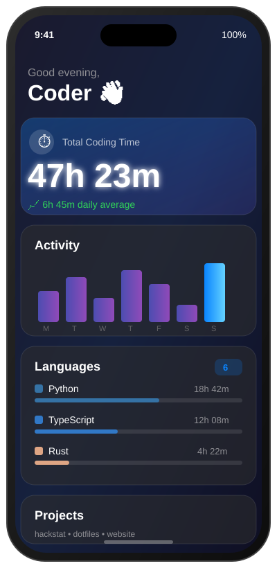
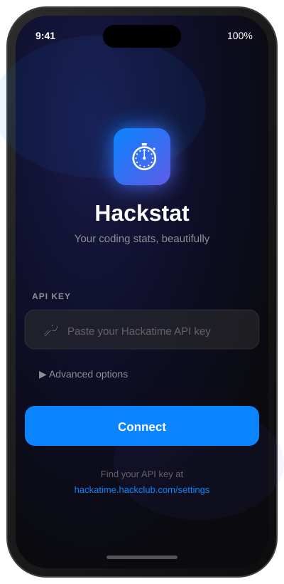

# Hackstat

> Your coding stats, beautifully. A gorgeous iOS client for [Hackatime](https://hackatime.hackclub.com) with iOS 27-inspired glassmorphic UI.

[](https://github.com/FBIopeningUPP/hackstat/actions/workflows/build-ios.yml)


<p align="center">
  
  &nbsp;&nbsp;&nbsp;&nbsp;
  
</p>

## ✨ Features

| Feature | Description |
|---------|-------------|
| 🎨 **iOS 27 UI** | Glassmorphic cards, blur effects, smooth animations |
| 📊 **Activity Charts** | Beautiful bar charts for daily coding activity |
| 🌈 **Languages** | Colorful progress bars for each language |
| 📁 **Projects** | Ranked by time spent |
| 🔧 **Editors** | Track VS Code, Vim, JetBrains, etc. |
| 🔄 **Pull to Refresh** | Instantly update stats |
| 🌙 **Dark Mode** | OLED-optimized |

## 📱 Install

### Quick Install

1. Go to [**Actions → Latest Build**](https://github.com/FBIopeningUPP/hackstat/actions)
2. Download **Hackstat-iOS** artifact
3. Install `.ipa` via **iLoader** / **SideStore** / **AltStore**

### Build Yourself

```bash
git clone https://github.com/FBIopeningUPP/hackstat.git
cd hackstat
flutter pub get
flutter build ios --release --no-codesign  # Requires macOS
```

## 🔧 Setup

```
1. Get API key → hackatime.hackclub.com/settings
2. Launch Hackstat
3. Paste key & connect
4. 🎉
```

## 🏗️ Structure

```
lib/
├── main.dart           # Entry point
├── models/             # Data models
├── screens/            # Home & Setup screens  
├── services/           # API client
├── theme/              # iOS 27 theme
└── widgets/            # Glass cards & charts
```

## 🔌 Compatibility

Works with any WakaTime-compatible API:

- ✅ [Hackatime](https://hackatime.hackclub.com) (Hack Club)
- ✅ [Wakapi](https://wakapi.dev)  
- ✅ [WakaTime](https://wakatime.com)

## 📄 License

MIT — do whatever you want!

---

<p align="center">
  Made with 💜 for <a href="https://hackclub.com">Hack Club</a>
</p>
